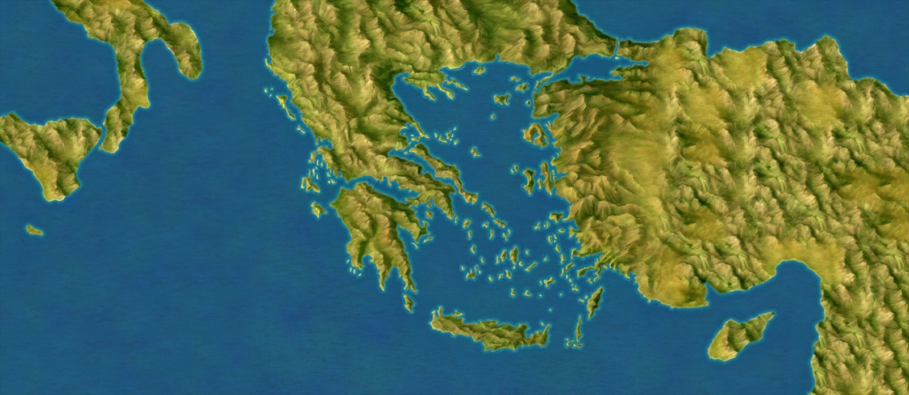
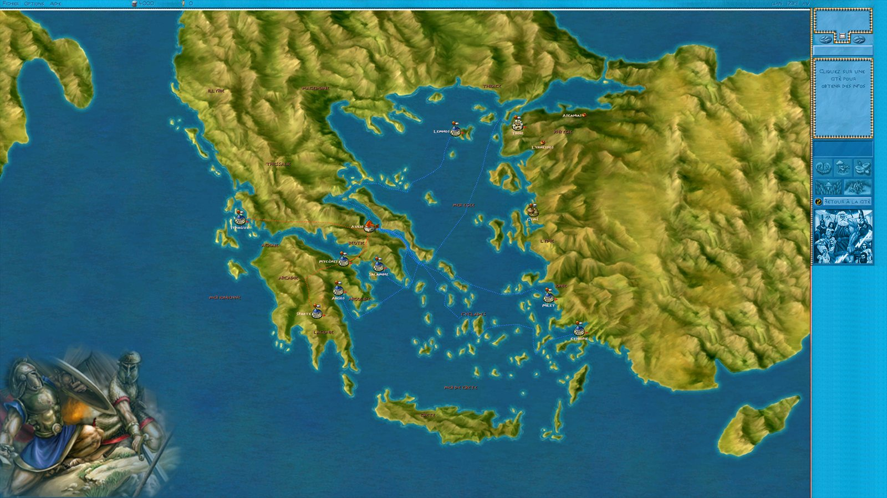
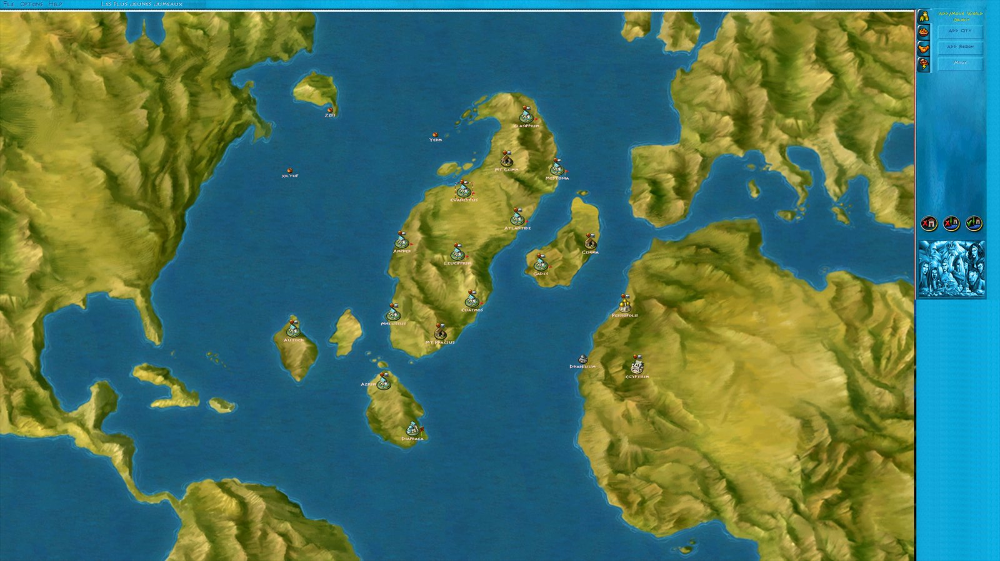

# Zeus - World Maps Tools

**Full-screen world maps for *Zeus: Master of Olympus* / *Poseidon* at any resolution: generator, converter and scenario editor patch**
· [Version française plus bas](#français)

*Generated world map (3440 x 1440, reduced): Greece between Italy and Anatolia.*

*In game (2560 x 1440): cities, region names and trade routes moved by the converter.*

*Patched scenario editor on a Poseidon map (2560 x 1440): cities placed anywhere on the original map, enlarged.*

At widescreen resolutions, the game shows the world map in a small corner of the screen. These tools make it full screen, **at any resolution**, from your own copy of the game. No game file and no world map is provided (the pictures below are screenshots).

- **World Map Generator** makes the 14 world maps (10 Zeus, 4 Poseidon) on your computer, from the original maps of your game, at the size of your exe's view. The map is centred. Greece sits between Italy and Anatolia: these lands are drawn once on a 3440 x 1440 reference (outline from Poseidon_map04, relief from the map of Greece), and every smaller resolution is a centred crop of it; the drawings in the bottom-left corner of maps 01-07 move to the bottom-left corner of the enlarged world map. Poseidon maps are drawn on a 1440p reference (neighbouring maps and real coastlines around); on wider screens, beside it: the Atlantis parchment panel with the god's portrait, textured water made from the map's own sea, or a picture of your choice, with or without a Greek key border.
- **World Map Converter** starts from the game's `Zeus.exe`: it checks its version and language (English 2.1.4.0 or French) and its resolution, **patches its scenario editor** for the enlarged world map (the original city zone, enlarged with the map, never outside the original map; any resolution, any world map, English or French exe; to our knowledge a first), then moves the cities, region names and trade routes of your scenarios (`.pak`, `.set`), editor maps (`.map`) and saved games (`.sav`) onto the enlarged map.

To play an English game in French, see **[Zeus - EXE French Patch](https://github.com/Vicinity4813/zeus-exe-french-patch)**.

## Download

Get `Zeus-World-Maps-Tools-1.0.zip` from the **[Releases](../../releases)** page: both programs, instructions in English and French, and the source code.

> Windows may show *"Windows protected your PC"* the first time, because the programs are new and unsigned: click **More info**, then **Run anyway**.

## Installation

1. The game must already run at the wanted resolution (GOG/Steam with a widescreen patch, JackFuste exe, Resolution Customiser…).
2. Run `World Map Generator.exe`, click **From a Zeus.exe…**, choose what goes beside the Poseidon maps, then click **Make the world maps**. The original maps are kept in `Mappemondes d'origine` and can be put back.
3. Run `World Map Converter.exe`, **choose the game's `Zeus.exe`** (required first), check the world map size it suggests (map centred, as in the generator), leave **Patch this exe's scenario editor** ticked, drag your `Adventures` and `Save` folders into the window and click **Convert**. A `.bak` copy of every original is kept, and **Restore the originals** puts them back.

Details: [docs/README.txt](docs/README.txt).

## What the converter does

- Changes only the world map positions (x' = x × scale + offset); every file is checked before it is written, and nothing is touched if in doubt.
- Recognises files it has already converted (never enlarged twice) and can switch to another size or position, from the original `.bak` when it is there.
- Converts every part of adventure saves, so routes stay in place after an episode change; repairs saves damaged by earlier versions.
- Handles official campaigns, tutorials, fan scenarios and editor maps, for the French and English versions of the game.
- English / French interface; command line: `"World Map Converter.exe" [--resolution 1080|1440|3440|WxH] [--taille WxH] [--exe Zeus.exe [--editeur]] [--sortie FOLDER] files...`

## Building

Run `build.cmd`: it uses the C# compiler that ships with Windows (.NET Framework 4) and produces `dist\World Map Converter.exe` and `dist\World Map Generator.exe`. `tools\make_release.ps1` builds the release zip.

## Credits and license

- Code: MIT License, see [LICENSE](LICENSE).
- Reading `.pak` / `.set` files is adapted from **zeus_mapper** by zawapl (Jakub Zawadzki), MIT License, see [LICENSE-zeus_mapper.txt](LICENSE-zeus_mapper.txt).
- Thanks to **JackFuste** for the widescreen exes the tools were tested on, and to **XJDHDR** (Impressions Resolution Customiser), whose offset table shows where the resolution is written in the English exe.
- Coastlines around the Poseidon maps: **Natural Earth** (naturalearthdata.com), public domain.
- *Zeus: Master of Olympus* / *Poseidon* are games by Impressions Games / Sierra. This is a fan project, not affiliated with them; it includes no game file and no world map from the game (only the screenshots in `docs/images`).

---

## Français

**Mappemondes plein écran pour *Le Maître de l'Olympe : Zeus* / *Poséidon* à n'importe quelle résolution : générateur, convertisseur et patch de l'éditeur de scénarios**

*Mappemonde générée (3440 x 1440, réduite) : la Grèce entre l'Italie et l'Anatolie.*

*En jeu (2560 x 1440) : cités, noms de régions et routes replacés par le convertisseur.*

*Éditeur de scénarios patché sur une carte de Poséidon (2560 x 1440) : cités placées partout sur la carte d'origine agrandie.*

En grand écran, le jeu affiche la mappemonde dans un petit coin de l'écran. Ces outils la passent en plein écran, **à n'importe quelle résolution**, à partir de votre propre exemplaire du jeu. Aucun fichier du jeu ni aucune mappemonde n'est fourni (les images ci-dessous sont des captures d'écran).

- **World Map Generator** fabrique les 14 mappemondes (10 de Zeus, 4 de Poséidon) sur votre ordinateur, à partir des cartes d'origine de votre jeu, à la taille de la vue de votre exe. La carte est au centre. La Grèce est entourée de l'Italie et de l'Anatolie : ces terres sont dessinées une fois sur une référence 3440 x 1440 (contour d'après Poseidon_map04, relief d'après la carte de la Grèce), et chaque résolution plus petite en est un recadrage centré ; les dessins du coin bas-gauche des cartes 01 à 07 passent dans le coin bas-gauche de la mappemonde agrandie. Les cartes de Poséidon sont dessinées sur une référence 1440p (cartes voisines et vraies côtes autour) ; sur un écran plus large, à côté : le panneau en parchemin Atlantis avec le portrait du dieu, de l'eau texturée faite à partir de la mer de la carte, ou une image de votre choix, avec ou sans frise grecque.
- **World Map Converter** part du `Zeus.exe` du jeu : il vérifie sa version et sa langue (anglais 2.1.4.0 ou français) et sa résolution, **patche son éditeur de scénarios** pour la mappemonde agrandie (la zone des cités d'origine, agrandie avec la carte, jamais hors de la carte d'origine ; n'importe quelle résolution, n'importe quelle mappemonde, exe anglais ou français ; une première, à notre connaissance), puis replace les cités, noms de régions et routes de vos scénarios (`.pak`, `.set`), cartes de l'éditeur (`.map`) et sauvegardes (`.sav`) sur la carte agrandie.

Pour jouer en français avec un jeu anglais, voir **[Zeus - EXE French Patch](https://github.com/Vicinity4813/zeus-exe-french-patch)**.

### Téléchargement

`Zeus-World-Maps-Tools-1.0.zip` sur la page **[Releases](../../releases)** : les deux programmes, les notices en français et en anglais, et le code source.

> Au premier lancement, Windows peut afficher *« Windows a protégé votre ordinateur »*, car les programmes sont récents et non signés : cliquez sur **Informations complémentaires**, puis **Exécuter quand même**.

### Installation

1. Le jeu doit déjà tourner dans la résolution voulue (GOG/Steam avec un patch widescreen, exe de JackFuste, Resolution Customiser…).
2. Lancez `World Map Generator.exe`, cliquez sur **D'après un Zeus.exe…**, choisissez ce qui va à côté des cartes de Poséidon, puis cliquez sur **Faire les mappemondes**. Les cartes d'origine sont gardées dans `Mappemondes d'origine` et peuvent être remises.
3. Lancez `World Map Converter.exe`, **choisissez le `Zeus.exe` du jeu** (obligatoire en premier), vérifiez la taille de mappemonde proposée (carte au centre, comme dans le générateur), laissez cochée **Patcher l'éditeur de scénarios**, glissez vos dossiers `Adventures` et `Save` dans la fenêtre et cliquez sur **Convertir**. Une copie `.bak` de chaque original est gardée, et **Restaurer les originaux** les remet en place.

Détails : [docs/LISEZMOI.txt](docs/LISEZMOI.txt).

### Ce que fait le convertisseur

- Il ne modifie que les positions de la mappemonde (x' = x × échelle + décalage) ; chaque fichier est vérifié avant d'être écrit, et rien n'est touché en cas de doute.
- Il reconnaît les fichiers déjà convertis (jamais agrandis deux fois) et peut passer à une autre taille ou position, depuis l'original `.bak` s'il est là.
- Il convertit toutes les parties des sauvegardes d'aventure : les routes restent en place après un changement d'épisode ; il répare les sauvegardes abîmées par les versions précédentes.
- Il gère les campagnes officielles, les didacticiels, les scénarios de fans et les cartes de l'éditeur, pour les versions française et anglaise du jeu.
- Interface en français et en anglais ; ligne de commande : `"World Map Converter.exe" [--resolution 1080|1440|3440|LxH] [--taille LxH] [--exe Zeus.exe [--editeur]] [--sortie DOSSIER] fichiers...`

### Compilation

Lancez `build.cmd` : il utilise le compilateur C# fourni avec Windows (.NET Framework 4) et produit `dist\World Map Converter.exe` et `dist\World Map Generator.exe`. `tools\make_release.ps1` prépare le zip de la release.

### Crédits et licence

- Code : licence MIT, voir [LICENSE](LICENSE).
- La lecture des fichiers `.pak` / `.set` est adaptée de **zeus_mapper** de zawapl (Jakub Zawadzki), licence MIT, voir [LICENSE-zeus_mapper.txt](LICENSE-zeus_mapper.txt).
- Merci à **JackFuste** pour les exe widescreen sur lesquels les outils ont été testés, et à **XJDHDR** (Impressions Resolution Customiser), dont la table d'adresses montre où la résolution est écrite dans l'exe anglais.
- Côtes autour des cartes de Poséidon : **Natural Earth** (naturalearthdata.com), domaine public.
- *Le Maître de l'Olympe : Zeus* / *Poséidon* sont des jeux d'Impressions Games / Sierra. Projet de fan, sans lien avec eux ; aucun fichier du jeu ni aucune mappemonde n'est inclus (seulement les captures d'écran de `docs/images`).
